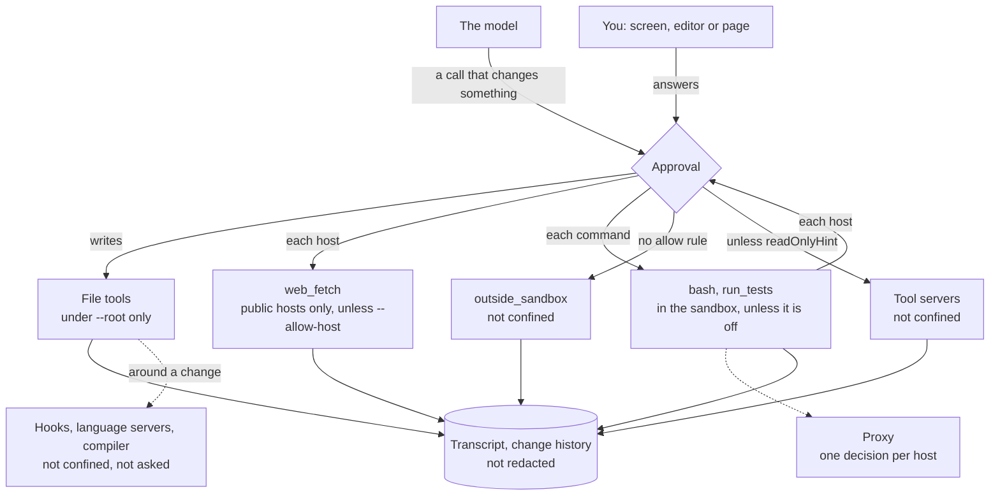

# Security

lokode gives a language model the ability to read your files, change them, reach the network and run commands.  
This document says what is enforced and what is not.

lokode is experimental software.
What is written here is what the code does today.

The defaults suit a machine you are experimenting on, not one that matters.
Nothing below has been audited.

The approval stands between the model and each tool that changes something.
The programs marked not confined run with your privileges.

## What is enforced

**Path confinement.** Every tool that takes a path resolves it through one function, which canonicalises the target and refuses anything that does not land under `--root`.

The function refuses a symlink that leaves the root, and a symlink whose target does not exist yet: the 2-step version, where creating the link is itself an allowed operation.

A file may be created under directories that do not exist yet.
The check applies to where the write would land, not to how the path was written.

Resolution and use are separate steps, so a link swapped in between would defeat it: the guarantee is against a confused model, not against another process on the machine racing it.

**A project is trusted before its settings act.** A project's `.lokode.toml` can start programs, allow commands without a question, widen what the shell may write, redirect the backend and its key, and write a log anywhere.

The project settings apply only once you have trusted them for that project, and again after any change to them.

A session without a terminal leaves those settings out unless `--trust-project` is passed.  
Project commands cannot take the name of a built-in.

**Approval before anything changes.** Writing a file, applying a patch, running a command, running the test suite and fetching a URL each require a decision.
`Enter` is not one of the accepting keys.

**Scoped agreements.** `[A]lways` is remembered against what the prompt showed: this exact command, writes by this tool under this directory, requests to this host.
So agreeing to one `ls` does not hand over the shell.

A command is matched in full rather than by the program at the front of it, because `ls` and `ls; rm -rf ~` share a first word.

An agreement is kept for the project in `$XDG_DATA_HOME/lokode/agreements.json` and holds in its later sessions.  
`/approve forget` takes them all back.

A run without a terminal does not use agreements.

**Rules read each command.** An `[approve]` rule is matched against each command of a line, substitutions included.  
An `allow` rule covers a line only when it covers every command and the line writes no file through a redirection.

A `deny` rule names commands as written.
A program run by another one, as with `xargs rm` or `find -exec rm`, is not seen by the rules.

**Egress.** The proxy and `web_fetch` share one guard.
`web_fetch` accepts only `http(s)`, resolves the host rather than trusting the name, and refuses loopback, link-local (including the cloud metadata address), RFC1918, CGNAT and unique-local addresses.

`web_fetch` follows redirects itself, so the same check runs on every hop, and asks again when a redirect leaves the host you approved.  
`--allow-host` opens a named exception.

**Bounded reads.** A file over 8 MiB is refused, a response body is streamed against a ceiling, and a file that is not text is refused.

**`lokode serve` listens on this machine only.** It binds 127.0.0.1, prints an address with a random token, and then asks for that token in a cookie that cannot be read by a script and is not sent across sites.

Every request's `Host` and `Origin` is checked, so a page elsewhere cannot reach it through your browser.

Whoever can reach the port and holds the token can answer your approvals: reach it from another machine through an ssh tunnel, not by listening wider.

**Atomic writes.** Files are replaced by writing beside them and renaming, so an interruption leaves the old contents or the new ones.  
A multi-file patch is applied wholly or not at all.

## What is not enforced

**A command runs in a sandbox, on Linux and macOS.** `bash` and `run_tests` run their command under a sandbox that the command and everything it starts cannot undo.

| System | Mechanism |
|---|---|
| Linux | Landlock |
| macOS | Seatbelt, through `/usr/bin/sandbox-exec` and a profile lokode writes |
| Windows | none: a command runs with your rights, whatever `[shell] sandbox` says |

| `[shell] sandbox` | What a command may write | Network |
|---|---|---|
| `workspace` (default) | the project, `/tmp`, `$TMPDIR`, the build caches below your home directory that exist, and `[shell] writable` | `proxy` |
| `read-only` | nothing but the devices under `/dev` | `closed` |
| `off` | anything you may write | open |

| `[shell] network` | What a command reaches |
|---|---|
| `proxy` (default in the workspace) | what the proxy lets through, host by host |
| `closed` | nothing |
| `open` | everything |
| `audit` | everything the rules do not refuse, and each host is recorded |

- **Through the proxy**, a command has no route of its own.
  `HTTP_PROXY`, `HTTPS_PROXY` and `ALL_PROXY` (SOCKS5) name the proxy of the session, and a token that belongs to that command.
  On Linux with `nft` installed, a program that ignores them is carried too.
  The namespace redirects every TCP connection to the proxy, and answers the name lookups itself with addresses of its own that stand for the names asked, so the question still names the host.
  Such a connection carries no lease, so it is carried only while exactly 1 command holds the network.
  Where `nft` is missing, or the kernel refuses the rules, a program that ignores the variables cannot connect.
  `git` over ssh is then provided for: `GIT_SSH_COMMAND` runs `lokode tunnel`, which carries the connection through the same proxy.
  Another client runs it as `ssh -o "ProxyCommand=lokode tunnel %h %p"`.
- **Each host is decided once per command**, by the same checks as `web_fetch`: the `egress` rules of the configuration, an agreement given with `Always`, then you.
  A refusal in the configuration wins.
  The question names the command and the host.
- **A name is not looked up before the host is agreed to**, because a lookup is itself a message that leaves the machine.
  The proxy resolves the name, refuses private, loopback and metadata addresses, and connects to the address it checked.
  `--allow-host` names an exception.
- **An upload larger than usual is put to you.**
  The proxy counts the bytes of every connection, whatever the protocol.
  A connection that sends several times more than any earlier one to its host is paused until you answer.
  Once it has received as much as the largest earlier upload, it must also send more for each byte received than any earlier one did.
  What is usual is learned from the connections already seen, kept for the project in `$XDG_DATA_HOME/lokode/egress-history.json`.
  The bytes a session sends to a host over all its connections are compared with the most an earlier session sent, so an upload cut into small connections is paused too.
  A project that has seen nothing yet has nothing to compare with, so the first upload of a connection is put to you, and its size becomes the first usual.
  The total of a session is not compared until an earlier session has ended.
- **`/net`** lists what commands reached.
  `/net save` writes the hosts agreed to with `Always` into `[approve.allow] egress` of `.lokode.toml`, so that the next person to work on the project does not answer the same questions.
- On Linux the proxy listens in a network namespace made with an unprivileged user namespace, and a command joins it before Landlock applies.
  The namespace has a loopback and no other route, so UDP and raw sockets are cut as well, and a service the command starts on its own loopback is reachable by it alone.
  Where the kernel does not allow the namespace, the network is closed and the session says so.
- On Linux the namespace includes a mount namespace in which the machine's runtime directory is empty, and so are the sockets that sit in the temporary directory when the session starts: the display, the terminal multiplexer and the key agents.
  The session bus, the user's service manager, the container engine and the key agents live there, and a program that reaches one of them starts a process outside the sandbox.
  A socket that is created elsewhere, or in the temporary directory after the session starts, is not hidden.
  macOS does not hide them.
- On macOS the profile cuts every IP socket except the proxy's own address.
- `closed` uses the same namespace on Linux, and Landlock on a system that has no namespace.
  Landlock leaves UDP open before ABI 4.
- `LOKODE_API_KEY` and the variable named by `api-key-env` are taken out of the command's environment.
- At every level but `off`, the credentials below your home directory cannot be read: `.ssh`, `.gnupg`, `.aws`, `.azure`, `.kube`, `.netrc`, `.git-credentials`, `.npmrc`, `.pypirc`, `.docker/config.json`, `.cargo/credentials.toml`, `.config/gh`, `.config/gcloud`, the keyrings, lokode's own configuration and its sessions.
  `[shell] hidden` adds to them.  
  Their names stay visible.
- `rm -rf ~` fails, and so does `cat ~/.ssh/id_rsa`.
  Everything else may be read.
- A `~` in `[shell] writable` is your home directory, and a relative name is in the project.  
  A name that does not exist is reported at startup.
- A command that fails tells the model it ran in the sandbox.
  The model may then ask to run it outside, with `outside_sandbox`.  
  That question reaches you: no `allow` rule answers it, and a run without a terminal refuses it.  
  An `[A]lways` given to it covers that exact command outside the sandbox.
- A sandbox asked for on a system that cannot confine refuses the command rather than run it unconfined.  
  On such a system with nothing asked, commands run unconfined and the session says so.

**The proxy filters by host, not by content.**
It sees the host and the port of a tunnel, and nothing of what travels in it.
A host you agreed to receives whatever a command sends it, and a service that relays, such as a paste site or an API that takes the sender's own key, is a way out.
A connection that names one host and reaches another through shared infrastructure, known as domain fronting, is not detected.
The detection of large uploads compares with what the project has done before: it catches a sudden flood, and a leak in small pieces stays under it.

**Outside the sandbox, a command is not confined.** It runs `/bin/sh -lc <string>` with your privileges and your environment.
`-l` sources your login profile.  
Approving a command is approving everything that command can do.

**`run_tests` runs the project's own code.** `cargo test` builds `build.rs`, `npm test` runs lifecycle scripts, `pytest` imports `conftest.py`.  
Approving it on a repository you have not read is approving whatever that repository wants to run.

**Checking a write runs the project's tools.** After a write, lokode asks the language servers that know the file, the built-in ones included.
Without one that can tell, it asks the compiler: `cargo check`, `tsc`, `go build` or `python3 -m py_compile`.  
Both run outside the sandbox, with your privileges, and neither is asked about.
A language server or a compiler may run code of the project, as `cargo check` runs `build.rs`.  
`[lsp] enabled = false` turns the language servers off.

**Nothing is redacted.** `.env`, `~/.aws/credentials` inside the root, a `.git/config` with a token in it.
All of it is readable by the model if it is under the root, and all of it is recorded in the session transcript.

The transcript is written with your umask, and nothing in it is encrypted.

**The change history holds copies of your files.** `/undo` and `/diff` work because every change is committed to a git repository under `$XDG_DATA_HOME/lokode/checkpoints/<session>`, whose work tree is the project.

The repository contains full copies of everything under the root that is not ignored, including anything sensitive, and it outlives the session.

The project's `.gitignore` is the only filter.  
Delete the directory when you are done with the session.

**An MCP server is a third party with your privileges.** It is a program you configured, and `lokode` starts it with the project as its working directory.
Nothing here confines what it does.

A call to one of the server's tools is approved, and the approval names the server.
Approving a call is approving whatever that program does with it.

A tool the server marks `readOnlyHint` runs without a question.
That mark is the server's own claim, and lokode does not check it.

**A plugin runs programs with your privileges.** Its hooks, tool servers and language servers are programs.  
Installing one shows what it runs and asks, and an update that changes what runs asks again.

`--yes` takes the install and the update without asking, which is what a script needs and what you should not give to a source you have not read.

A marketplace is a git repository whose plugins you chose to list.  
An archive is unpacked as ordinary files, without links, names that leave the directory or special permission bits.

A plugin written for another coding agent is read the same way and runs the same way.

**An editor that starts `lokode acp` is trusted as you are.** It names the project and the tool servers a session starts, and it answers the approvals.

A project's settings that wait for trust stay out of such a session, since nobody can be asked: run `lokode` in the project once to trust them.

**A tool server can ask the model and you.** A question it puts to the model is approved first, and a form it puts to you is yours to fill or decline.

A token you signed in with is kept in `mcp-tokens.json` in the data directory, readable by you alone, and a server's tools are not reached by a token meant for another.

**An agent in the background works in a copy of the project.** The copy holds the files git does not track, ignored files left out, and the objects it is made of are kept in the repository's own store until git collects them.

The agent's writes and commands are asked about as yours are, in the copy, and `take_work` brings in what it did without asking again.

A copy whose work is left stays on disk with its path said.

**Intent is not checked.** Tool arguments are validated and repaired, and a call to a tool that does not exist is refused.  
A well-formed call to delete the right file is indistinguishable from a well-formed call to delete the wrong one.

Approval is the only thing between the calls, so the prompts say what they ask.

**Prompt injection is not addressed.** Content read from a file or fetched from the web reaches the model as ordinary text.  
A repository that contains instructions aimed at an agent will have them read.

The approval prompts are the mitigation, and they only work if you read them.

## Running it more safely

- Point `--root` at one project, not at your home directory.
- Decline `[A]lways` for `bash` unless you know what the project's sessions are going to do.
- Keep the sandbox on, and add the caches your builds need to `[shell] writable`.
- Prefer a container or a VM for a repository you have not read.
- Keep an API key in the environment rather than in a config file.
  If you do put one in a file, lokode refuses to use it unless the file is private to you.
- Read `$XDG_STATE_HOME/lokode/lokode.log` and the session transcript afterwards.
  Every approval decision and every tool call is in them.

## Reporting a vulnerability

Open an issue at https://github.com/loken-ai/lokode/issues.  
If it is something that should not be public first, say so in an issue with no detail and a maintainer will arrange a private channel.

Things worth reporting: a way out of `--root` through a path-taking tool, a way to reach a private address through `web_fetch`, a way to get a tool to run without the approval it is supposed to require, or a way to make a credential appear in a log or on screen.
