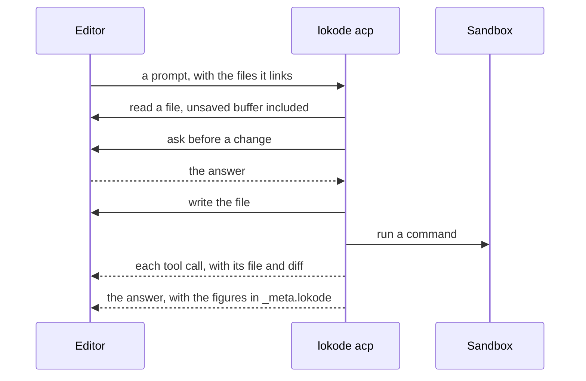

# Editors, browser and terminal

## In an editor

`lokode acp` serves an editor over the Agent Client Protocol, on its standard input and output.
Zed, the JetBrains IDEs, Neovim, Emacs and VS Code with the ACP Client extension can run it.  
In Zed:

```json
"agent_servers": {
  "lokode": { "command": "lokode", "args": ["acp"] }
}
```

Flags go before `acp`: `lokode --tool-protocol native acp`.

| In the editor | What lokode does |
|---|---|
| A new session | Opens a session for the editor's project, configured as the terminal would be |
| A recorded session | Comes back to it, replays the conversation, in the mode it was left in |
| A prompt | Runs a turn. A file the editor links is read as an `@` mention |
| `/` | Offers the terminal's commands and the project's, and runs them |
| A tool call | Shows it with its file, and an edit with its diff |
| A change | Asks first, with what `Always` would cover |
| A mode | Act, accept edits or plan |
| Stop | Stops the turn |



- A file is read from the editor when the editor offers it.
  lokode puts a write on disk itself when the editor did not.
- A command never runs in a terminal of the editor's.
- `_meta.lokode` holds the turn's time, steps, tokens, files changed, window and energy.
- The tool servers the editor names join those of the configuration.
- A tool server's form is put to the editor when it can show one, and declined otherwise.
- A project's settings that wait for trust stay out, since nobody can be asked.
  Run `lokode` once in the project to trust them, or give the editor `--trust-project`.

## In a browser

`lokode serve` serves the project's sessions to a browser page, on 127.0.0.1 only.
It prints the address to open, with a token that the page then keeps in a cookie.

<!-- site: figure name=web-approval alt="The page of lokode serve: a change waits for an answer, with its diff and 3 buttons" caption="The page of lokode serve: a change waits for an answer, with its diff and 3 buttons" -->

```sh
lokode serve --port 8420
```

- The page shows the thread, each step with its diff, the approvals and the tool servers' forms as cards, and a rail with the plan, the changes, the window and the energy.
- `/` offers the commands, as in the terminal.
  Enter sends, esc stops the turn.
- A session goes on when its page is closed.
  A page opened later attaches to it, with what it said and what it still waits on.
  Several pages can follow one session.
- The page speaks the Agent Client Protocol, its events on a stream and its messages posted.
- Another machine reaches it through an ssh tunnel: `ssh -L 8420:127.0.0.1:8420 host`.
- The `Host` and `Origin` of every request are checked, so a page elsewhere cannot reach it.

### In the terminal

`lokode attach <address>` draws a session of a running `lokode serve` in this terminal, with the address it printed.
It follows the latest session open, or `--session <id>`, or a new one.

<!-- site: figure name=session-90 alt="The same screen at a narrow width: the rail gives way to the conversation" caption="The same screen at a narrow width: the rail gives way to the conversation" -->

- The thread, the steps, the approvals and the forms are the terminal's own, answered here.
- What is typed goes to the server, a `/command` included, so it runs where the session lives.
- Several terminals and pages can follow one session at once.

### Sharing sessions with other machines

`lokode serve --share` lets the dashboards of a group of machines follow and drive the sessions of this server.
The group is a name and a secret, written once on every machine in the configuration of the user.

```toml
[dashboard]
name = "home"
secret = "a long phrase that only these machines know"
seeds = ["192.0.2.7:41000"]
```

- The server announces itself to the group on the local network and listens on it, which it does not do without `--share`.
- A machine without the secret cannot finish the handshake, and what travels is encrypted.
- `seeds` lists servers to reach where multicast does not cross, as `host:port`.
- Only the user's own configuration is read for `[dashboard]`, never the file of a project.
- The file that holds the secret must not be readable by others.

## Without the interface

`-p` (`--prompt`) runs one turn and exits.

```sh
lokode -p "fix the clippy warnings" --approve edits --output json
```

| Policy | |
|---|---|
| `--approve none` | the default. Anything that would change something is declined, and reading and searching still work |
| `--approve edits` | writes, edits and patches are allowed. The shell, the test suite and the network stay refused |
| `--approve all` | everything is allowed |

Each call is judged on its own.
A policy never grants a standing agreement.

`--output text` streams the answer to stdout and the progress to stderr.

`--output json` writes one object at the end: the result, every tool call with its output, what was refused and the energy.
The call of a write carries `check`: `passed`, `failed` or `not-checked`.

| Exit code | |
|---|---|
| `0` | finished |
| `1` | something failed: a backend error, or the step limit |
| `2` | a tool was refused by the policy |
