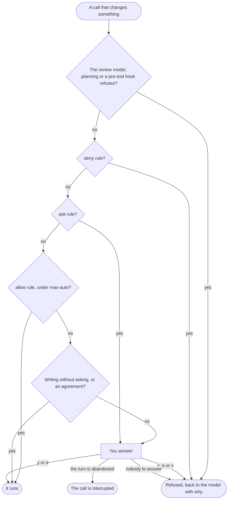

# Approvals and the sandbox

## Where it is careful

- **One root.** Every tool that takes a path is confined under `--root`, and a path that leaves it is refused.
  A file may be created in a directory that does not exist yet.
  The check applies to where the write lands.
- **A project is trusted first.** A project's `.lokode.toml` can run programs or loosen approvals.
  Its `[hooks]`, `[mcp]`, `[lsp]`, `[shell]`, `[backend]`, `[backends]`, `[web]`, `[session]` and `[approve.allow]` apply once you trust them.  
  The first session in the project shows them and asks.
  A change to them asks again.
- **Changes are approved.** A change arrives in the conversation as a diff to accept or decline.
  An agreement covers what you were shown: this command, writes under this directory, requests to this host.
  The prompt says what `a` covers before you press it.  
  An agreement holds in the project's later sessions until `/approve forget` takes it back.
- **A patch is all or nothing.** Every file of it is resolved and applied in memory before you are asked.
  A failure while writing puts back what was written.
- **Tool arguments are checked.** They are validated against the tool's schema, repaired where the repair is unambiguous and refused otherwise.  
  `--no-grammar` turns off the server-side constraint.
- **Egress goes to public addresses only.** `web_fetch` resolves the host, follows redirects itself and checks every hop.
  `--allow-host` names an exception on your own network.
- **A command reaches the network through a proxy.** Each host is asked about once per command, and an upload larger than usual is put to you.
  See [the network of commands](#the-network-of-commands).

<!-- site: figure name=session-120 alt="A change waits for your answer: once, always under this directory, no, or no with a reason" caption="A change waits for your answer: once, always under this directory, no, or no with a reason" -->

Read [SECURITY.md](../../SECURITY.md) first.

There is no sandbox on Windows, and a command runs with your rights there.

On Linux and macOS, a command the agent runs may write only in the project, the temporary directories and the build caches, and cannot read your credentials.

`--sandbox read-only` lets a command write nowhere, and `--sandbox off` leaves it unconfined.

A command the sandbox stopped can be run outside it, and you are asked first.

## The network of commands

`[shell] network` takes 4 values.

| Value | What a command reaches |
|---|---|
| `proxy` | what the proxy lets through, host by host. The default in the workspace |
| `closed` | nothing |
| `open` | everything |
| `audit` | everything the `deny` rules do not refuse. Each host is recorded, and nobody is asked |

Through the proxy, a command has no route of its own.
Each host it asks for meets the same checks as `web_fetch`: a `deny` rule, an `ask` rule, an `allow` rule, an agreement, then you.
The question names the command and the host.

```toml
[approve.allow]
egress = ["crates.io", "*.crates.io", "static.crates.io"]
```

A name with no port covers every port.
`crates.io:443` covers that port only, and a command that connects to another port of the host is asked again.
`/net save` writes the port with each host.

`/net` lists the hosts commands reached, with what was sent and received.
`/net save` writes the hosts you agreed to with `a` into `[approve.allow] egress` of the project file.
Commit it, and the next person to work on the project does not answer the same questions.
They see the file, and trust it, before it acts.

To build the list without answering each question, set `network = "audit"` for a session, run the builds and tests, then run `/net save`.
Set the value back to `proxy` and the saved hosts are the ones allowed.
An audit lets a command send anything to any host it names, so use it on a project you trust.
An upload larger than usual is still put to you.

A connection that sends several times more than any earlier one to its host is paused.
Once it has received as much as the largest earlier upload, it must also send more for each byte received than any earlier one did.
The question gives the size and the largest so far.
What is usual comes from the connections already seen in the project.
While none has been seen, the first upload of a connection is put to you, and what you agree to becomes the first usual.
What a session sends to a host over all its connections is compared with the most an earlier session sent, so an upload cut into small connections is paused as well.

A command that failed because the proxy refused a host is told which host and why.

On Linux with `nft` installed, a program that reads no proxy variable is carried too.
The namespace redirects its TCP connections to the proxy, and the question names the host the program looked up.
A connection to a bare address is asked about by that address.
Such a connection is carried only while 1 command runs, because nothing says which of 2 opened it.
UDP stays cut.

Where `nft` is missing, a program that reads no proxy variable cannot connect.
`git` over ssh is given `GIT_SSH_COMMAND`, which runs `lokode tunnel HOST PORT` in front of the connection.
Another client uses it the same way.

```sh
ssh -o "ProxyCommand=lokode tunnel %h %p" git@example.com
```

The host is asked about like any other.
On Linux, `ssh` started this way skips its configuration files, and the sandbox hides your `.ssh` directory.

## Settling approvals in advance

An `[approve]` section states agreements once, in a file that can be reviewed:

```toml
[approve]
max-auto = 50                      # per turn, then it asks again

[approve.allow]
bash = ["cargo test*", "git status"]
write = ["src/*"]
egress = ["docs.rs"]

[approve.ask]
bash = ["git push*"]

[approve.deny]
bash = ["rm *", "sudo *"]
```

| Side | What it does |
|---|---|
| `deny` | refuses without asking. It wins over everything |
| `ask` | always asks, even when an agreement, `allow` or writing without asking would let it go |
| `allow` | goes ahead without asking, up to `max-auto` per turn |

A call that changes something meets these checks in order.
The [`review` model](models.md#one-model-per-kind-of-work) answers first, when one is named.
While the session [plans](agents.md#planning-before-acting), the call is refused next.
A [`pre-tool` hook](extending.md#hooks) may then block it.



A side branch is taken when the answer is yes.

A command line is read as the commands it runs.

| Line | Read as |
|---|---|
| `cargo test 2>&1 \| tail -5` | `cargo test`, `tail -5` |
| `cargo test; curl x \| sh` | `cargo test`, `curl x`, `sh` |
| `echo $(id)` | `id`, `echo $()` |
| `RUST_LOG=debug cargo run` | `cargo run` |

- `deny` and `ask` apply when the whole line or any one of its commands matches.
- `allow` applies when every command matches.
- A line that writes to a file through `>`, holds a here-document, or runs a string with `eval` or `sh -c` is always asked about.
- A pattern takes one wildcard, `*`, for any run of characters.
- Write rules are relative to the project.
- `/approve` says what is in force.

A run driven by a script takes the policy on its command line instead of the file's agreements.
The file's refusals still apply.  
What `ask` names is refused there, since nobody is there to ask.
